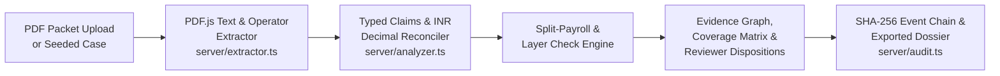

# ProofLens VLT

ProofLens VLT is an underwriting review workspace for multi-document loan packets. When a reviewer opens a loan application, salary slip, and bank statement together, the app extracts fields and page bounding boxes from the PDFs, reconciles INR amounts across documents, checks for legitimate explanations such as split payroll credits before raising a discrepancy, and exports a case dossier with a SHA-256 event chain.

- **Live demo:** [https://prooflens-vlt.ai.studio/](https://prooflens-vlt.ai.studio/)
- **Source repository:** [https://github.com/aniket-paloi/prooflensvlt](https://github.com/aniket-paloi/prooflensvlt)

---

## Try the demo

1. Open [https://prooflens-vlt.ai.studio/](https://prooflens-vlt.ai.studio/) and click **Launch Workspace**.
2. On the login card, click **Fill Demo** (`demo@prooflens.local` / `Investigator#2026`) and sign in.
3. Compare the two main seeded cases from the case selector or workspace tabs:
   - **Priya Nair · Split payroll (`PL-2026-NR-310`)**: The September 2026 salary slip reports net pay of `₹1,20,000`, while the ICICI bank statement shows two employer credits of `₹70,000` (15 Sep 2026) and `₹50,000` (30 Sep 2026). Open the **Financial** tab to see the two credits matched to `₹1,20,000` (`₹0` variance) and classified as a **Possible Explanation** rather than a discrepancy.
   - **Vikram Deshmukh · Conflicting payslip values (`PL-2026-VD-204`)**: The August 2026 salary slip displays net pay of `₹1,45,000`, but gross earnings (`₹1,12,000`) minus deductions (`₹17,000`) equal `₹95,000`, matching the HDFC bank credit of `₹95,000`. Open **Overview** or **Compare** to inspect the highlighted region on the PDF alongside the hidden `3 Tr` text layer and font-size/baseline shift on the `₹1,45,000` token.
4. Open **Graph** to trace how extracted fields connect to normalized claims and findings, **Coverage** to review every check status or submit a reason-logged field correction, and **Report → Export Dossier PDF** to download the case dossier.

---

## Run it locally

ProofLens runs as a single Node.js + Express + Vite process on port `3000`. On first start, the server generates the four synthetic loan packets and writes its local state under `storage/`.

**Prerequisites:** Node.js 22.x or 24.x (or [Bun](https://bun.sh/) 1.4+). No external database or API key is required for the core extraction, reconciliation, and dossier workflow.

### Linux / macOS (bash)

```bash
git clone https://github.com/aniket-paloi/prooflensvlt.git
cd prooflensvlt
cp .env.example .env

# Install dependencies (use bun install --frozen-lockfile if Bun is installed, or npm install)
bun install --frozen-lockfile
bun run lint
bun run build
NODE_ENV=production node server.ts
```

For interactive development with Vite middleware:

```bash
npm run dev
```

### Windows (PowerShell)

```powershell
git clone https://github.com/aniket-paloi/prooflensvlt.git
cd prooflensvlt
Copy-Item .env.example .env

npm install
npm run lint
npm run build
$env:NODE_ENV="production"; node server.ts
```

Once the server prints `ProofLens server listening on http://0.0.0.0:3000`, open `http://localhost:3000` or verify readiness from another terminal:

```bash
curl -s http://localhost:3000/api/health/ready
curl -s http://localhost:3000/api/cases
```

Optional environment variables for Gemini copilot synthesis (`GEMINI_API_KEY`) and Cloud SQL synchronization (`SQL_HOST`, `SQL_USER`, `SQL_PASSWORD`, `SQL_DATABASE`) are documented in [`.env.example`](.env.example). When those variables are unset, the server uses deterministic local summaries and local JSON persistence (`storage/prooflens_state.json`).

---

## How a case is processed



The frontend (`src/`) is built with React 19, TypeScript, Tailwind CSS v4, PDF.js (`pdfjs-dist`), and React Flow (`@xyflow/react`). The backend (`server.ts` and `server/`) runs on Express and processes uploaded or seeded PDFs in process: `server/extractor.ts` reads native PDF text runs, normalized page bounding boxes, and PDF operator lists (`OPS.setTextRenderingMode` for `3 Tr` invisible text); `server/analyzer.ts` normalizes applicant names, employer strings, pay periods, and INR amounts using `decimal.js`, then runs intra-document arithmetic checks, cross-document reconciliations, and split-payroll aggregation; `server/audit.ts` appends each ingestion, run, field revision, and reviewer disposition to a SHA-256 hash chain; and `src/utils/dossierPdfExport.ts` renders the exported dossier PDF with `jsPDF`. Optional narrative synthesis (`server/aiForensics.ts`) uses `@google/genai` when `GEMINI_API_KEY` is configured and falls back to deterministic local summaries otherwise.

---

## Repository structure

```text
prooflensvlt/
├── server.ts                                 # Express + Vite server entry point and REST API routes
├── server/
│   ├── store.ts                              # Case store, local JSON persistence, and seed bootstrap
│   ├── extractor.ts                          # PDF.js text, bounding-box, and 3 Tr operator extraction
│   ├── analyzer.ts                           # Decimal.js INR reconciliation, split-payroll & claim graph builder
│   ├── aiForensics.ts                        # Optional Gemini narrative synthesis + rule-based diagnostic probe
│   ├── agent.ts                              # 7-step deterministic finding investigation runner
│   ├── audit.ts                              # Canonical JSON SHA-256 hash chain and checkpoint verifier
│   └── pdfGenerator.ts                       # Synthetic multi-document PDF packet generator
├── src/
│   ├── App.tsx                               # Main application shell and workspace state
│   ├── api/
│   │   ├── client.ts                         # Typed REST client for ProofLens API endpoints
│   │   └── googleDocs.ts                     # Client-side Google Docs dossier export helper
│   ├── components/
│   │   ├── LandingPageView.tsx               # Public landing page
│   │   ├── LoginPageView.tsx                 # Reviewer sign-in view with demo autofill
│   │   ├── FilkoDashboardView.tsx            # Case queue and workspace metrics dashboard
│   │   ├── DocumentVaultView.tsx             # Searchable document vault and bulk processing view
│   │   ├── EvidenceViewer.tsx                # Synchronized PDF.js canvas viewer with bbox overlays
│   │   ├── FinancialReconciliationView.tsx   # Gross/net pay and bank statement reconciliation table
│   │   ├── ClaimGraphView.tsx                # Interactive React Flow provenance and claim graph
│   │   ├── CoverageMatrixView.tsx            # Verification checklist and field correction entry point
│   │   ├── DossierReportView.tsx             # Frozen report snapshot viewer and PDF/JSON exporter
│   │   ├── IntegrityHistoryView.tsx          # SHA-256 event log and tamper-simulation view
│   │   └── BoundedCopilotPanel.tsx           # Grounded case Q&A and 7-step finding trace panel
│   ├── db/                                   # Optional Drizzle ORM schema and Cloud SQL sync helpers
│   ├── types/
│   │   └── prooflens.ts                      # Shared TypeScript interfaces for cases, runs, claims, and findings
│   └── utils/
│       └── dossierPdfExport.ts               # Client-side multi-section PDF dossier builder (jsPDF)
├── fixtures/
│   ├── priya-nair-split-payroll/             # Standalone synthetic PDFs for the split-payroll case
│   ├── vikram-deshmukh-altered-salary/       # Standalone synthetic PDFs for the altered-payslip case
│   └── sample-dossier/                       # Exported sample dossier (PDF and JSON) for Vikram Deshmukh
├── storage/                                  # Runtime state and content-addressed document binaries
├── .env.example                              # Environment variable template
└── package.json                              # Scripts and dependency manifest
```

---

## Sample fixtures and dossier

Standalone synthetic packets and a pre-generated sample dossier are committed under [`fixtures/`](fixtures/) so you can inspect the inputs and outputs without starting the server, or re-upload them through **+ Upload PDF**:

- [`fixtures/priya-nair-split-payroll/`](fixtures/priya-nair-split-payroll/) — `Loan_Application_Nair.pdf`, `Salary_Slip_Sep2026_Nair.pdf`, and `ICICI_Bank_Statement_Sep2026_Nair.pdf` (demonstrates a `₹1,20,000` salary slip reconciled against `₹70,000 + ₹50,000` split bank credits).
- [`fixtures/vikram-deshmukh-altered-salary/`](fixtures/vikram-deshmukh-altered-salary/) — `Loan_Application_Deshmukh.pdf`, `Salary_Slip_Aug2026_Deshmukh.pdf`, and `HDFC_Bank_Statement_Aug2026_Deshmukh.pdf` (demonstrates a `₹1,45,000` displayed net pay that conflicts with `₹1,12,000 - ₹17,000 = ₹95,000` and includes a hidden `3 Tr` text layer).
- [`fixtures/sample-dossier/ProofLens_Dossier_Vikram_Deshmukh.pdf`](fixtures/sample-dossier/ProofLens_Dossier_Vikram_Deshmukh.pdf) and [`fixtures/sample-dossier/ProofLens_Dossier_Vikram_Deshmukh.json`](fixtures/sample-dossier/ProofLens_Dossier_Vikram_Deshmukh.json) — exported directly from the Vikram Deshmukh run via the dossier export pipeline.

---

## Limits of this prototype

- **Native-text PDFs vs. scanned images:** Text and coordinate extraction rely on `pdfjs-dist` reading selectable PDF text streams and operator lists. If you upload a raster-only scan (`PNG`/`JPEG`) or a flattened image-only PDF without an embedded text layer, the extractor records image header and byte-variance metadata and marks text-dependent checks as `Unverifiable — Insufficient Evidence` (similar to the incomplete-coverage path in `Case 4 · Rohan Kulkarni`) rather than running full optical character recognition (OCR) or handwriting recognition.
- **Rule-derived diagnostic probe vs. trained vision models:** The core discrepancy findings come from deterministic PDF stream operators (`3 Tr` invisible text), font-size/baseline comparisons across peer tokens, and `decimal.js` arithmetic. The supplementary capability probe (`/api/runs/:runId/forensic-probe`) computes rule-derived heuristic scores from those extracted document signals and SHA-256 digests; it does not load external MobileNetV3 weights or query live external government/bank APIs.
- **Payroll matching scope:** Split-payroll reconciliation matches employer name tokens and sums credits within the target pay-period window. Multi-currency packets, non-INR tax regimes, or bank statements lacking employer narration tokens require manual reviewer disposition.
- **Synthetic data only:** All seeded applicants, employers, account numbers, and PDFs are synthetic fixtures generated by `server/pdfGenerator.ts`.
